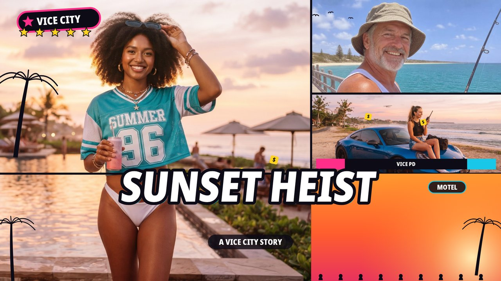
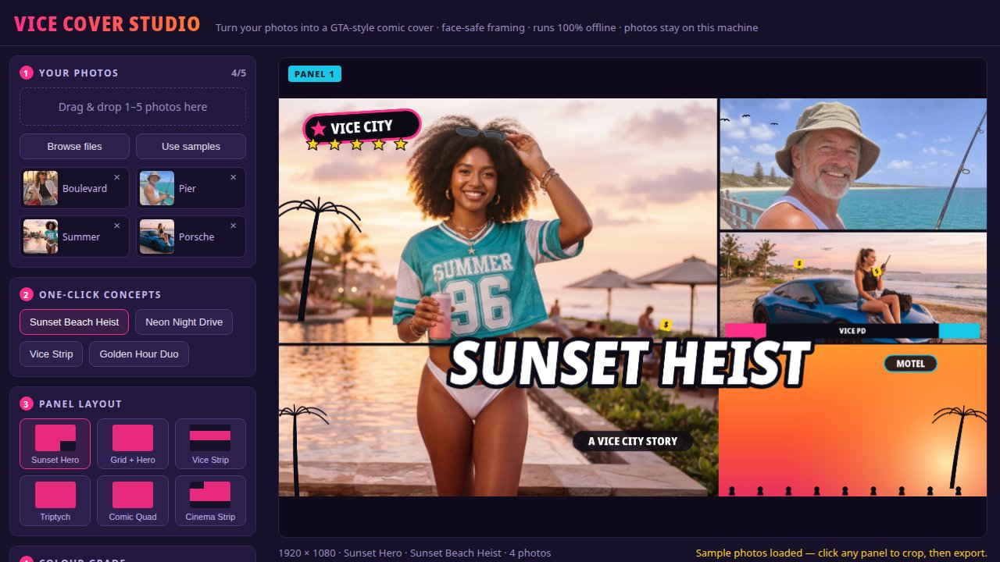
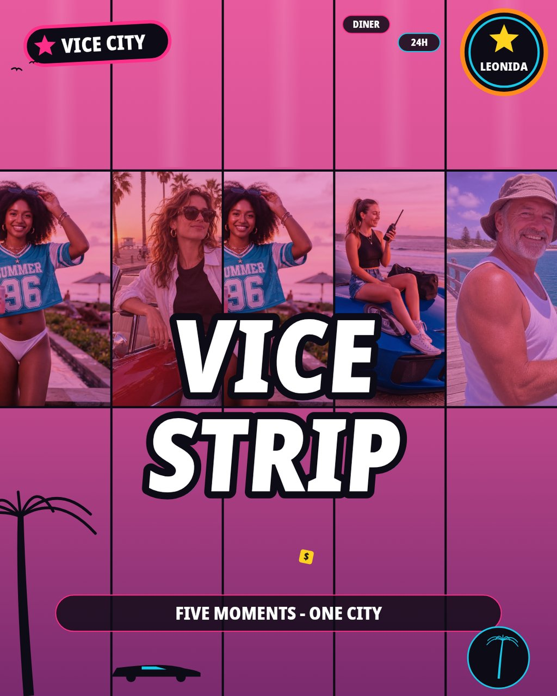
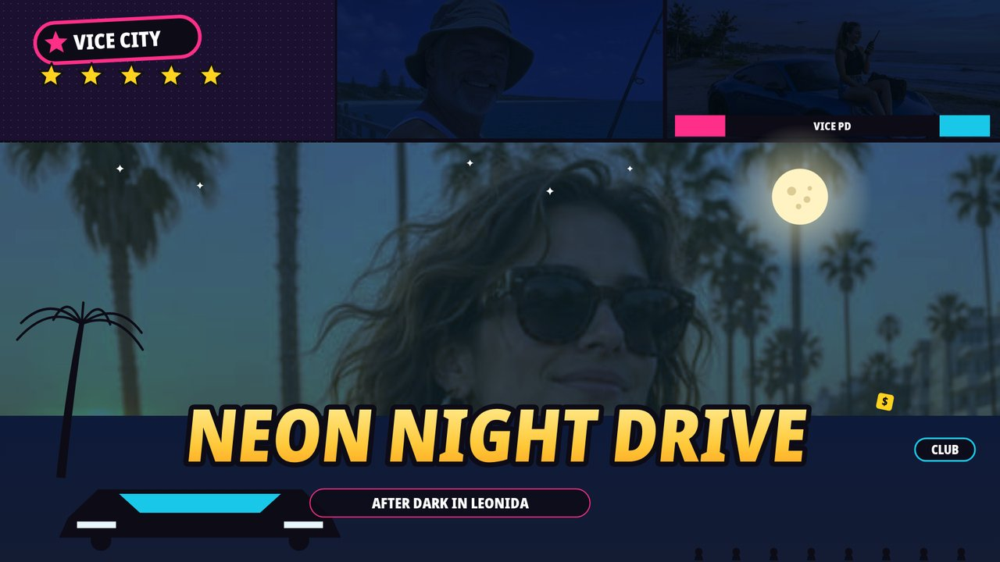

# Vice Cover Studio — GTA-style cover art maker

[](https://make.fun/competitions/gta6-cover-art-01)
[](https://make.fun/competitions/gta6-cover-art-01)
[](https://make.fun/competitions/gta6-cover-art-01)

An offline web app that turns your photos and a caption into a GTA 6-style
multi-panel comic cover — the Vice City neon-sunset poster look — and exports
it as a PNG to share. No upload, no server, no watermark: the photos never
leave your machine.

## What it does

- **Load 1–5 photos** (drag & drop, browse, or use the four built-in samples).
- **One-click concepts** — four ready-made covers: Sunset Beach Heist,
  Neon Night Drive, Vice Strip and Golden Hour Duo.
- **Panel layouts** — six arrangements (Sunset Hero, Grid + Hero, Vice Strip,
  Triptych, Comic Quad, Cinema Strip) you can swap under any concept.
- **Colour grades** — Sunset, Neon, Vice Pink and Golden washes.
- **Caption** — edit the big title and the subtitle; the lettering is drawn
  in the genre's style (condensed black capitals, white fill, black stroke,
  cyan fringe).
- **Face-safe framing** — every panel crops on a face anchor, so faces are
  never cut off. A self-check reports 0 faces cut across all concepts and
  sizes.
- **Export** — PNG at 1080×1080, 1080×1350 or 1920×1080, one click.

## Run it

```sh
node serve.ts
# open http://localhost:8080
```

No build step, no dependencies, no network request: `app/` is plain static
files (ES modules, one local font, four sample photos).

## Hand it in

```sh
mkdir -p out && MAKEFUN_OUTPUT_DIR=out node main.ts
# writes out/dossier.json and copies app/ + screenshots/ into out/
```

## How it is built

- `app/src/ink.js` — the drawing primitives: badge, stars, titles, pills,
  palms, cars, moon, stickers.
- `app/src/photos.js` — the sample-photo catalogue (face anchors), the
  cover-crop solver and the photo painter.
- `app/src/concepts.js` — the four cover recipes: panel layouts plus the
  dressing (grade, badge, stars, title, decorations).
- `app/src/studio.js` — the editor: state, live preview, export, shot mode.
- `app/src/shots.js` — the four screenshot scenes.
- `app/src/main.js` — bootstrap.

## Screenshots

| | |
|---|---|
|  |  |
|  |  |

## Licence

MIT. The sample photos were made for make.fun and are free to use. No
Rockstar logos, artwork or fonts are used anywhere.
